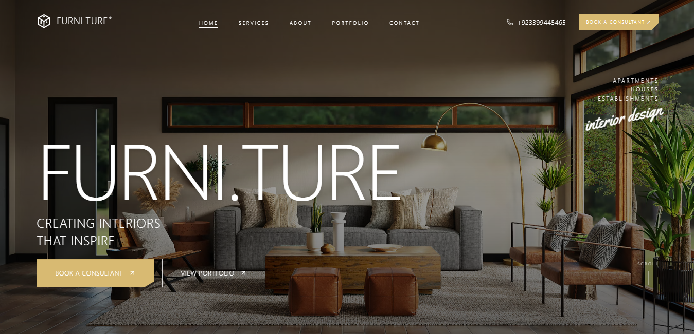

<div align="center">

# FURNI.TURE®
### Minimalist & Luxury Scandinavian Interior Design Studio

<p align="center">
  A high-end, editorial web experience showcasing turnkey interior renovations, bespoke architectural designs, and customized design consultations.
</p>



<br/>

[](https://nextjs.org/)
[](https://react.dev/)
[](https://www.typescriptlang.org/)
[](https://tailwindcss.com/)
[](https://motion.dev/)

</div>

---

## ✨ Overview

**FURNI.TURE®** is a modern editorial web application designed for a luxury Scandinavian interior design studio. Inspired by Nordic minimalism, warm earthy tones, and editorial typography, it combines smooth physics-based scroll interactions with an architectural layout.

---

## 🚀 Key Features

- **🏛️ Monumental Editorial Aesthetics:** Curated typography hierarchy utilizing Inter paired with handcrafted signature scripts, muted taupe/mocha accents, and minimal borders.
- **📜 3D Parallax Card Stacking:**
  - **Hero to Services Stack:** The hero section smoothly recedes with 3D depth and subtle ambient darkening while the Services card slides over it.
  - **FAQ to Footer Stack:** The FAQ card recedes as the dark mocha contact footer effortlessly overlays from beneath.
- **🖼️ Curated Portfolio & Case Studies:** Precision image layout showcasing residential apartments, turnkey renovations, and commercial spaces with a full-resolution interactive lightbox modal.
- **❓ Refined FAQ Accordion:** Clean, single-open accordion ensuring zero viewport crowding and immaculate layout stability across all screen heights.
- **🤝 Design Consultation Booking:** Interactive modal form allowing visitors to schedule tailored interior design consultations directly with studio architects.
- **⚡ Next.js 15 & React 19:** Built on Next.js App Router for optimal SEO, lightning-fast rendering, and smooth client transitions.

---

## 🛠️ Tech Stack

| Technology | Purpose |
| :--- | :--- |
| **[Next.js 15](https://nextjs.org/)** | App Router architecture, SSR & metadata optimization |
| **[React 19](https://react.dev/)** | Component architecture & modern state primitives |
| **[TypeScript](https://www.typescriptlang.org/)** | Strict type safety and maintainable codebase |
| **[Tailwind CSS v4](https://tailwindcss.com/)** | Utility-first responsive design system |
| **[Motion](https://motion.dev/)** | Smooth scroll-linked parallax, transforms, and card stacking |
| **[Lucide React](https://lucide.dev/)** | Clean minimalist iconography |
| **[Google GenAI SDK](https://github.com/google-gemini/generative-ai-js)** | Gemini integration for intelligent design consultations |

---

## 📁 Project Structure

```text
furniture-website/
├── app/                      # Next.js App Router pages & root layout
│   ├── layout.tsx            # Global fonts, metadata & root providers
│   ├── page.tsx              # Main studio homepage
│   ├── about/                # Studio philosophy & about page
│   ├── services/             # Turnkey services & supervision
│   ├── portfolio/            # Architecture & renovation showcase
│   └── contacts/             # Contact details & studio inquiry
├── components/               # Modular UI components
│   ├── Hero.tsx              # Main hero section with editorial lockup
│   ├── HeroServicesStack.tsx # Parallax stacking between Hero & Services
│   ├── ServicesSection.tsx   # Alternating service rows with micro-animations
│   ├── AboutSection.tsx      # Studio numbers & double-frame photography
│   ├── PortfolioSection.tsx  # Balanced image grid and case study previews
│   ├── PortfolioLightboxModal.tsx # Fullscreen HD photo preview
│   ├── TestimonialCarousel.tsx    # Client reviews & social proof slider
│   ├── FaqFooterStack.tsx    # Parallax stacking between FAQs & Footer
│   ├── FaqAccordion.tsx      # Clean single-expansion FAQ system
│   ├── FooterSection.tsx     # Full-bleed mocha contact footer
│   ├── Header.tsx            # Auto-contrast sticky navigation bar
│   ├── ConsultantBookingModal.tsx # Consultation reservation dialog
│   └── ContactModal.tsx      # Direct inquiry dialog
├── context/                  # Global application state (modal controls)
├── lib/                      # Studio static data, schema & test suites
└── public/                   # Static assets & studio photography
    └── assets/
        └── aistudio/
            └── Hero.png      # Studio preview banner
```

---

## 🏁 Getting Started

### Prerequisites

Ensure you have [Node.js](https://nodejs.org/) (version 18.18 or later) installed.

### Installation

1. **Clone the repository:**
   ```bash
   git clone https://github.com/AliAskariGithub/Furniture-Website.git
   cd Furniture-Website
   ```

2. **Install dependencies:**
   ```bash
   npm install
   ```

3. **Configure environment variables:**
   Create a `.env.local` file in the root directory (refer to [.env.example](.env.example)):
   ```env
   GEMINI_API_KEY="your_gemini_api_key_here"
   ```

4. **Start the local development server:**
   ```bash
   npm run dev
   ```
   Open [http://localhost:3000](http://localhost:3000) in your browser to explore the website.

---

## 🧪 Testing & Linting

```bash
# Run type checks
npx tsc --noEmit

# Run unit tests
npm test

# Run code linter
npm run lint

# Build production bundle
npm run build
```

---

## 📄 License

This project is licensed under the MIT License — see the [LICENSE](LICENSE) file for details.
